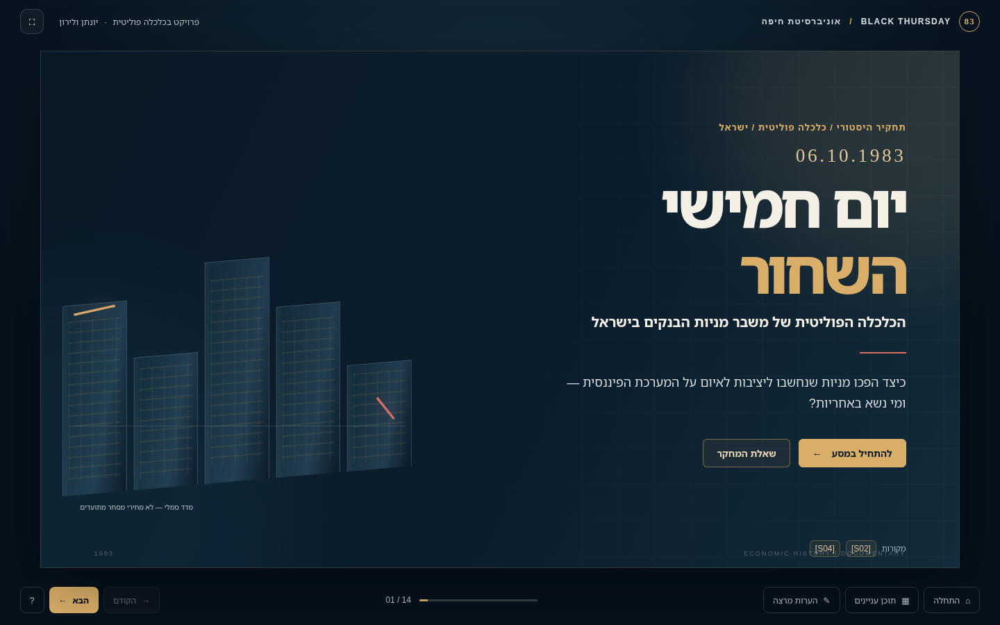
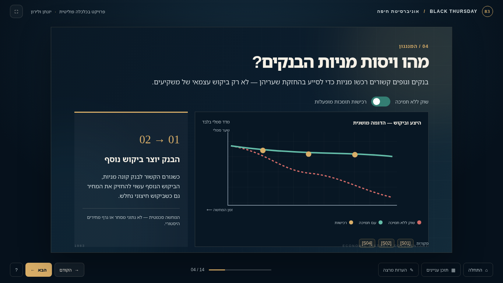
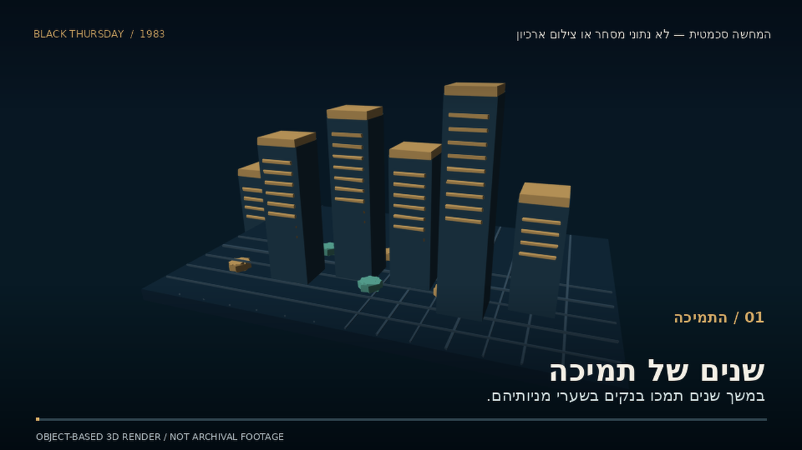
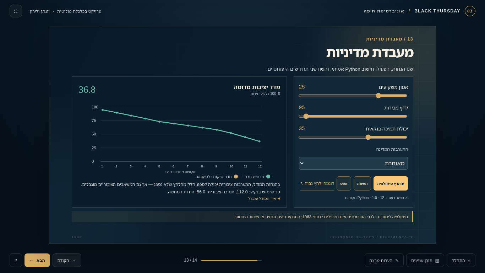

# BLACK THURSDAY — יום חמישי השחור
### הכלכלה הפוליטית של משבר מניות הבנקים בישראל, 1983

**University of Haifa · Political Science · Semester A, 2026/27**  
**Team: Yonatan & Liron**  
**Status:** Functional, self-contained implementation bundle; **not yet merged into the existing GitHub project or submitted**.



## A documentary you can navigate

This interactive Hebrew right-to-left 14-slide presentation examines the incentives of banks, investors, regulators and government that contributed to Israel's October 1983 bank-share crisis. It includes schematic animated diagrams, source notes, a code-rendered 3D documentary animation, and a Python-driven policy lab.

**Research question:** כיצד תרמו התמריצים והפעולות של בנקים, משקיעים, רגולטורים ומנהיגים פוליטיים למשבר מניות הבנקים ב־1983, ומה מלמדת ההתערבות הממשלתית על אחריות, פיקוח וחלוקת סיכונים?

The closing slide's institutional lessons are **student analytical propositions requiring final team approval**, not quotations from a judicial ruling or official commission.

## Real screenshots from this build

| Bank-share regulation — interactive schema | 3D explanatory video, actual rendered frame | Python-generated chart |
|---|---|---|
|  |  |  |

All drawings are original. The graph on slide 04 and the toy model on slide 13 are **not observations from 1983**.

## Start the presentation

Prerequisite: **Python 3.11+**. The app works even when Flask is not installed, through a tested built-in Python server. For Flask specifically, optional command: `python -m pip install 'Flask>=3,<4'`.

**Windows PowerShell** (from the unzipped project folder):

```powershell
python python/app.py
```

**macOS / Linux**:

```bash
python3 python/app.py
```

Open **http://127.0.0.1:8000/** in Chrome, Edge or Firefox. Keep that terminal window running. The server binds only to your computer (`127.0.0.1`), and no keys, accounts, network connection or paid services are necessary for the deck.

The deck is **not** a PowerPoint file; it is a real navigable HTML presentation as required by the course.

## How to use it

Use visible buttons **הבא / הקודם / התחלה / תוכן עניינים**, or keyboard **← next**, **→ previous**, **Home first**, **End last**; `Esc` closes a source or notes drawer. URL hashes `#/slide/13` point to specific slides. Press the upper-left ⛶ to enter full screen.

- Slide 03: select an actor and view incentives and accountability questions.
- Slide 04: switch market-support states. The two curves are **schematics**, not stock data.
- Slide 05: click money and information flows.
- Slide 06: raise selling pressure and watch the finite support reservoir.
- Slide 07: explore historical timeline stages.
- Slide 09: **play, pause and scrub the embedded video**. The scene is computer-generated original 3D, not archival footage.
- Slide 13: move three sliders, select state intervention, run a model in Python, keep a prior case with **השווה**, and compare curves. The demo does not fabricate calculations if Python is offline.
- Source chips on slides: bibliographic details and external source links. **הערות מרצה** gives slide-specific speaking notes.

## What is actually implemented

| Component | Files | Function |
|---|---|---|
| RTL narrative presentation | `presentation/index.html`, `styles.css`, `slides-data.js`, `app.js` | Editable, keyboard-driven 14-slide deck, original diagrams, sources and notes |
| 3D scene sources | `animation/scene.html`, `scene.js` | Raw WebGL 3D mesh rendering with matrices, perspective camera and lighting; separate browser preview |
| 3D encoded movie | `animation/render_movie.py`, `media/video/crisis-animation.mp4` | Actual **H.264 / 1280×720 / 72s** original 3D software-rendered video included in slide 09; silent with embedded Hebrew captions |
| Python back end | `python/app.py` | Flask when installed, otherwise compatible stdlib fallback; same `GET /api/health` and `POST /api/simulate` API |
| Deterministic economics model | `python/simulation.py` | 12 hypothetical periods; finite bank capacity + finite public capacity |
| QA and research | `python/tests`, `docs/`, `research/` | Tests, method disclosure, research verification ledger, release checklist |
| Development evidence | `prompts/2026-11-01-master-implementation-prompt.md` | The actual supplied input prompt; no invented prompts or Git commits |

### Technical flow

```text
Browser controls --POST /api/simulate--> Python Flask / wsgiref
   ^                                       |
   |------ real JSON values and chart <----+

Object-based 3D geometry + camera + lighting
   --> local CPU render + FFmpeg --> embedded H.264 MP4 --> slide 09 video player

Separate inspectable WebGL scene source: animation/scene.html
```

## Test on a clean machine

```bash
python -m unittest discover -s python/tests -v
```

Eight tests verify deterministic output, input bounds, budget depletion, outcome sensitivity, invalid requests, and the stdlib API. For sample API check:

```bash
curl http://127.0.0.1:8000/api/health
curl -X POST http://127.0.0.1:8000/api/simulate -H 'Content-Type: application/json' -d '{"confidence":65,"sell_pressure":50,"bank_capacity":55,"intervention":"early"}'
```

See `docs/testing-report.md` for observations and untested cases, `animation/EXPORT.md` for the actual video method and re-export instructions, and `docs/model-methodology.md` for the **non-historical coefficients**.

## Research, integrity and caveats

Primary anchors: [1993 State Comptroller](https://library.mevaker.gov.il/sites/DigitalLibrary/Pages/Publications/641.aspx), [2021 Yale case study](https://elischolar.library.yale.edu/journal-of-financial-crises/vol3/iss3/13/), [Bank of Israel's inflation overview](https://www.boi.org.il/information/bankipedia/moneyandeconomy/hyperinflation/), [Supreme Court record](https://www.new.isa.gov.il/images/Fittings/isa/asset_library_pic/al_enforce_asset_library_/page_enforce_pdf_pages-63187a7a0aceb/2910-94.pdf). Detailed ID mapping and remaining verification tasks: `research/sources.md` and `research/claim-register.csv`.

- Tel Aviv Stock Exchange was closed on **6 October 1983 for 18 days**; specific 24/25 October reopening is omitted pending primary-source clarification.
- **445% annual inflation** is from **1984**, not 1983. The **1985 economic stabilization** program was a separate later intervention.
- State Comptroller's approximately **US$9.1 billion through October 1991** is **cumulative expenditure including attributed financing**, **not necessarily ultimate net taxpayer loss**. One must deduct proceeds from eventual bank-share sales.
- Finance Minister **Yoram Aridor's resignation (13 October 1983)** was linked to a proposed dollarization policy and must not be cast as the sole cause of the share crisis.
- Media use original geometric objects and film frames; **no unauthorized newspaper or lecture-PDF content** was reissued. Source rights: `media/ASSET-CREDITS.md`.

## Existing repository integration (IMPORTANT)

Our course GitHub repository is `https://github.com/yonti32-ux/polsci01-assignment-01-Project-Black-Thursday`. The original project and committed **root PRD.md** were **not accessible in this build environment**. This bundle was deliberately made **without a fake PRD or local Git history** to avoid overwriting team work. Merge the bundle into the existing working checkout, preserving original `PRD.md`, remote, commits, licenses and any partner changes. Resolve any file conflicts by reviewing them, not bulk overwriting.

Suggested real next commit after review: `feat: add RTL documentary deck with 3D film and Python policy lab`. Pushing, lecturer access and Moodle submissions are **not yet performed**. The previously discussed eight-character group code **`polsci01`** still needs verification against the official Moodle exercise instructions; each member must submit the required individual reporting PDF. See `docs/release-checklist.md`.

## Attribution

Developed and edited by the project team **Yonatan & Liron** with AI-assisted code and copy. Students retain responsibility for historical accuracy, interpretive claims and academic submission.
