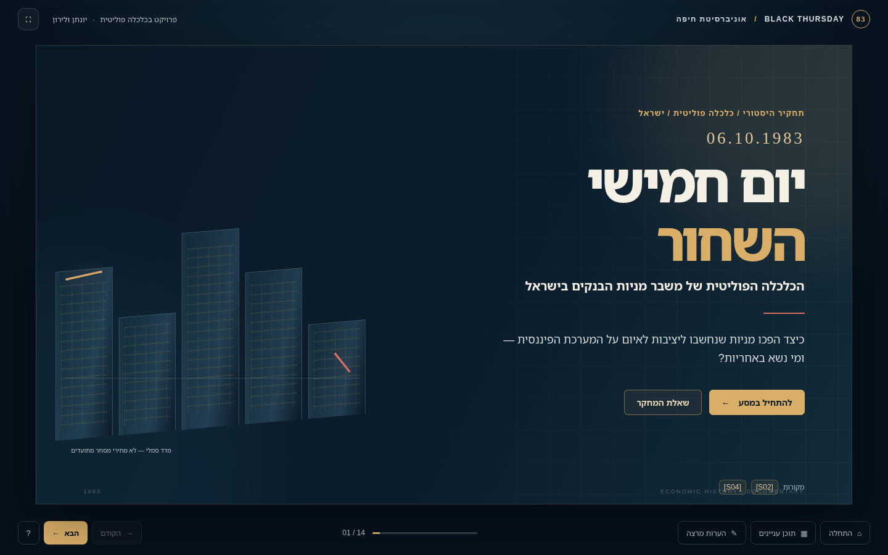
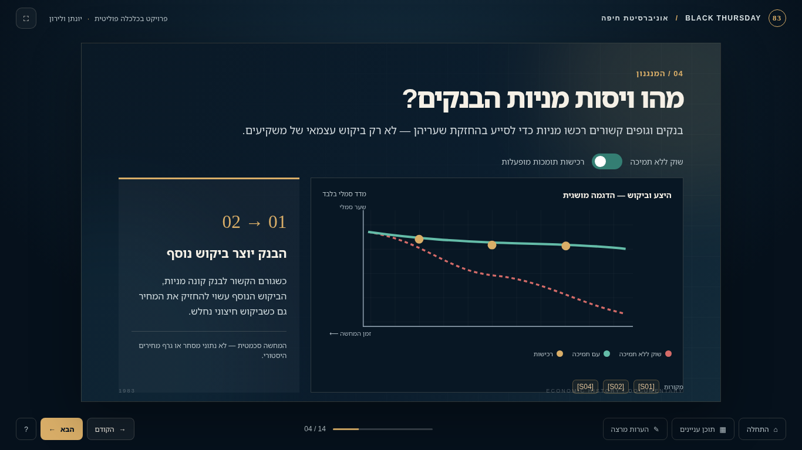
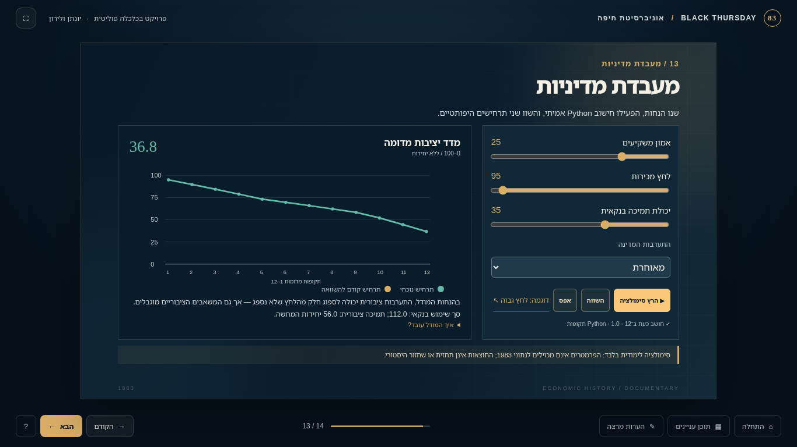

# BLACK THURSDAY · יום חמישי השחור

**An interactive political-economy documentary about the 1983 Israeli bank-share crisis**  
**University of Haifa · Political Science · AI Vibe Coding · Assignment 01**  
**Team:** Yonatan and Liron · **Group code:** `polsci01` (exactly eight characters)  
**Project status (2 November 2026):** **Release candidate for final team + external review** — working prototype and media included; browser/sign-off/administrative checks remain.  
**Live GitHub repository:** confirm the correct URL/remote before submitting (see [Repository verification](#repository-verification)).



> **Project in one minute:** A navigable **14-slide Hebrew RTL HTML presentation** uses original graphics, a code-rendered **82-second 3D-backed documentary video**, historical sources, and a **real Python-powered interactive simulator** to explain how long-running bank-share price support became an economic and political crisis in October 1983. The simulator is hypothetical, not a reconstruction of actual market prices.

## 🎯 Research question

**כיצד תרמו התמריצים והפעולות של הבנקים, המשקיעים, רשויות הפיקוח והמנהיגים הפוליטיים למשבר מניות הבנקים של 1983, ומה מלמדת התערבות המדינה על אחריות ציבורית וחלוקת סיכונים?**

We focus on institutional incentives, conflicts of interest, accountability, market confidence, systemic risk, and the distribution of costs between financial institutions and the public. The crisis is **not** attributed to one political figure.

## 🚀 Run the project

### Recommended: one-click Windows launch

1. Clone or download the **complete repository**, then extract it completely if downloaded as a ZIP.
2. Install **Python 3.11 or newer** (ensure `python` or `py -3` works in a terminal).
3. Double-click **[`START_BLACK_THURSDAY.bat`](START_BLACK_THURSDAY.bat)** in the repository root.
4. The launcher opens **http://127.0.0.1:8000/**. Leave its console window open while presenting.
5. Navigate to slide 9 for the video and slide 13 for the interactive Python simulation.

The Python app uses Flask if available; otherwise it uses a **Python standard-library fallback**, so the presentation should run without additional Python packages on a compatible Python installation. If port 8000 is occupied, stop the existing service or change the port consistently in the launcher and server.

**macOS/Linux:** `sh START_BLACK_THURSDAY.sh` or `python3 launch_presentation.py`.

**Manual launch:**

```bash
cd Project-Black-Thursday-deliverable
python python/app.py
```

### Quick viewing without Python

Open `Project-Black-Thursday-deliverable/presentation/index.html` as a local HTML file. The **slides and video can be viewed** in browsers that allow their local relative assets, but **slide 13 needs Python**; the UI warns rather than falsely pretending to calculate results. For the class evaluation and full feature demonstration, **use the one-click launcher**.

### Controls

- **←** next slide; **→** previous slide; **Home / End** jump to the first / last slide.
- The on-screen table of contents jumps to a selected slide; presenter notes display contextual explanations and sources.
- Slide 9 has embedded playback controls for the approved **v3 film**.
- Slide 13 accepts four parameters (confidence, selling pressure, bank capacity, intervention timing), runs the **real Python model**, and renders twelve **illustrative** periods; scenarios can be compared or reset.

## 🎬 Latest 3D documentary — Liron's visual direction


The current **`crisis-animation-v3.mp4`** is an **82-second, 1280×720, H.264** movie created with code-rendered 3D geometry and an abstract, animated financial-documentary overlay. It is built around **seven visual stages**. Liron's feedback drove the centered Hebrew text cards, uniform restrained motion, historically qualified numerical graphics, institutional analysis and prescribed palette:

`#1c242c` · `#c19d43` · `#d3cebe` · `#1f3c58` · `#8ab9ee` · `#7a8694` · `#e7eef4` · `#f5cb39` · `#ed1c16`

Positive returns use blue, negative values red and documentary text beige. **The source technique is raw WebGL / Python rendering, not Three.js.** The original PRD proposed Three.js, but the actual implementation employs genuine 3D geometry and code-generated video. See [v3 export notes](Project-Black-Thursday-deliverable/animation/EXPORT_v3.md) and the [contemporary QA record](docs/history/ITERATION_v0.5_VIDEO_QA.md).

**Verified historical figures depicted in the video:** January–September **1983 real returns** were **+8.6% for all commercial-bank shares** and **−57.5% for nonbank shares**, as listed in the December 1984 State Comptroller report, Table 1.3 (printed p. 19). They are **not** single-day 6 October price changes, historical banking-index levels, or Python simulation data.


## 🖼️ Other real presentation screenshots

| Schematic share-support mechanism | Hypothetical policy simulator |
|:---:|:---:|
|  |  |

These images are captures from the working project, not prospective mockups. Captions indicating abstract illustrations are intentional.

## 🐍 Python: real computation, clearly hypothetical model

```text
Desktop browser
  ├─ 14-slide RTL HTML presentation (HTML / CSS / JS)
  ├─ embedded local code-rendered 3D documentary (MP4)
  └─ slide 13 user controls
            │ JSON POST /api/simulate
            ▼
  Python local server (Flask OR stdlib WSGI)
            │
            ▼
  Deterministic 12-period educational stress model
            │ JSON result
            ▼
  On-screen interactive chart and explanation
```

Core source paths: [`python/simulation.py`](Project-Black-Thursday-deliverable/python/simulation.py), [`python/app.py`](Project-Black-Thursday-deliverable/python/app.py), and [model assumptions](docs/model-methodology.md). The model is illustrative, with finite support budgets and arbitrary teaching parameters. **It is not fitted to 1983 market data and cannot establish what would actually have happened under other policies.**

**Run tests** from the `Project-Black-Thursday-deliverable/` folder:

```bash
python -m unittest discover -s python/tests -v
```

Latest independent command-line verification during documentation review (2 November 2026): **8/8 tests passed**; local server returned HTTP 200 for `/`, `/api/health`, the v3 video and presentation JavaScript. A full browser-to-server interaction was **attempted** but blocked by the evaluation environment (`ERR_BLOCKED_BY_ADMINISTRATOR`). The team must run it in Chrome/Edge before final sign-off. See [final review report](docs/FINAL_REVIEW_REPORT.md).

## 🧭 Presentation and research content

The 14-slide structure moves from economic context and banking actors, through the price-support mechanism and 1983 selling pressure, to the exchange suspension, 3D film, intervention, public exposure, Bejski inquiry, Python policy lab and political-science conclusions. Slides include research source IDs and presenter notes.

Historical sources include the **1984 State Comptroller report** (*דו״ח על מניות הבנקים — משבר אוקטובר 1983*), the separate **1993 State Comptroller report** on government holdings, Yale's *Israeli Bank Shares Arrangement* case, a Bank of Israel research paper, and the Ministry of Justice legal retrospective. The research register used by the live slides is [`research/sources.md`](Project-Black-Thursday-deliverable/research/sources.md) and [`claim-register.csv`](Project-Black-Thursday-deliverable/research/claim-register.csv). Earlier Phase 3 research is retained in [`docs/history/`](docs/history/) as **archived planning evidence, not the current source-ID authority**.

**Historical integrity safeguards:**

- **6 October 1983:** stock-exchange trading was suspended; do not depict the exchange building physically collapsing or all bank deposits disappearing.
- The banking share-support system ran for years; **Yoram Aridor** was **Finance Minister**, not the sole person who created the crisis.
- Distinguish the **October 1983 bank-share arrangement** from the **July 1985 stabilization plan**.
- Distinguish share-support inventory, estimated future rescue commitments, **gross public expenditure**, and the state's eventual **net financial loss**; these are not interchangeable.
- The video, schematic graphs, and 12-period model are not filmed archival events or reconstructed share-price histories. Label them as illustrations or simulations.
- The slides' source IDs apply only to the current app registry. The archived Phase 3 source ID scheme is different; see [crosswalk](docs/history/SOURCE_ID_CROSSWALK.md).
- Any reused archival media must have checked attribution and redistribution rights; see [`media/ASSET-CREDITS.md`](Project-Black-Thursday-deliverable/media/ASSET-CREDITS.md).

## 🗂️ Repository map (canonical current structure)

```text
README.md                       ← this project homepage
PRD.md                          ← current v1.3 specification + history
START_BLACK_THURSDAY.bat        ← Windows full-feature launcher
START_BLACK_THURSDAY.sh         ← macOS/Linux launcher
launch_presentation.py          ← launcher helper
Project-Black-Thursday-deliverable/
  presentation/                ← live HTML/CSS/JS deck
  media/video/                 ← v3 film + prior genuine versions
  media/screenshots/           ← actual screenshots
  animation/                   ← inspectable 3D source + exports
  python/                      ← local server, simulation and tests
  research/                    ← canonical slide-source registry
  docs/                        ← implementation notes
prompts/                       ← real prompt history, including Liron's revisions
docs/
  FINAL_REVIEW_REPORT.md        ← current technical/historical audit
  RELEASE_CHECKLIST.md         ← check-off tasks before submission
  SELF_ASSESSMENT.md            ← team rationale / score placeholder
  reviews/                     ← independent Gemini assessment
  history/                     ← original PRD, early storyline, older QA
```

**Why no `v04/` or `v05/` duplicate build directories?** Earlier versions belong in Git commit history and the documented prompts/QA. This review candidate retains *one canonical runnable presentation* and preserves substantive historical files rather than three competing copies of the application. The source ZIP and its `.git` history should remain backed up until the candidate is merged into the real clone.

## 🧪 Project process and review

1. Initial PRD and initial story concept; historical research corrected the original one-person explanation.
2. HTML presentation, animation, and Python educational model were built, committed and tested.
3. Liron requested a clearer, more abstract, precisely styled 3D video; v2 and v3 iterations and captured output were recorded.
4. Additional **1984 primary-source data** was used to correct the return visualization and sharpen regulatory accountability.
5. The current stage is **final consolidation**, followed by **independent Gemini red-team evaluation** and targeted final corrections, if any.

See [real prompts](prompts/), [original document history](docs/history/), [final audit](docs/FINAL_REVIEW_REPORT.md), and [Gemini review prompt](prompts/06-gemini-independent-review-prompt.md). **Do not invent prompt exchanges, reviewer scores, screenshots or user tests.**

## ✅ Submission and academic self-assessment

- **GitHub** must be **public** or grant the lecturer access at `rmisegal@gmail.com` (a teammate's collaborator access alone is insufficient). Confirm the correct remote URL before sharing it.
- The team has an exactly eight-character code: **`polsci01`**.
- Both students must **individually** submit the official university **Word form saved as PDF** to Moodle; **do not submit Word** or change the template layout. Assuming exercise number `01`, the filename is **`polsci01-ex01.pdf`**. Verify the Moodle exercise number and deadline.
- **Gemini's score is an independent red-team assessment**, not a Moodle submission. Save a faithful summary or the unedited feedback in [`docs/reviews/`](docs/reviews/) and explain any changes. Then set the team's **recommended self-grade in the designated field of the official submission form**, with a justification consistent with the final work. If there is no field, follow Moodle/lecturer instructions instead of adding free text to the template.
- The official PDF may contain private student ID numbers: **do not commit it to a public repository**. Each student uploads it privately to Moodle.

The project is a **release candidate**, not a claim of final university approval. The [release checklist](docs/RELEASE_CHECKLIST.md) contains outstanding browser, reviewer and access checks.

## Repository verification

**Repository URL discrepancy detected in the student's uploaded ZIP:** its embedded Git remote is `https://github.com/yonti32-ux/AI-Vibe-coding--assignment-01-Project-Black-Thursday`, whereas an earlier conversation supplied `https://github.com/yonti32-ux/polsci01-assignment-01-Project-Black-Thursday`. We could **not** verify which one is accessible from this environment. Run `git remote -v` in your actual clone and confirm the publicly accessible or lecturer-authorized URL **before** submitting a link. Do not change the remote based on guesswork.

---
*Documentation review date: 2 November 2026 · Team: Yonatan & Liron · Project code: `polsci01`.*
