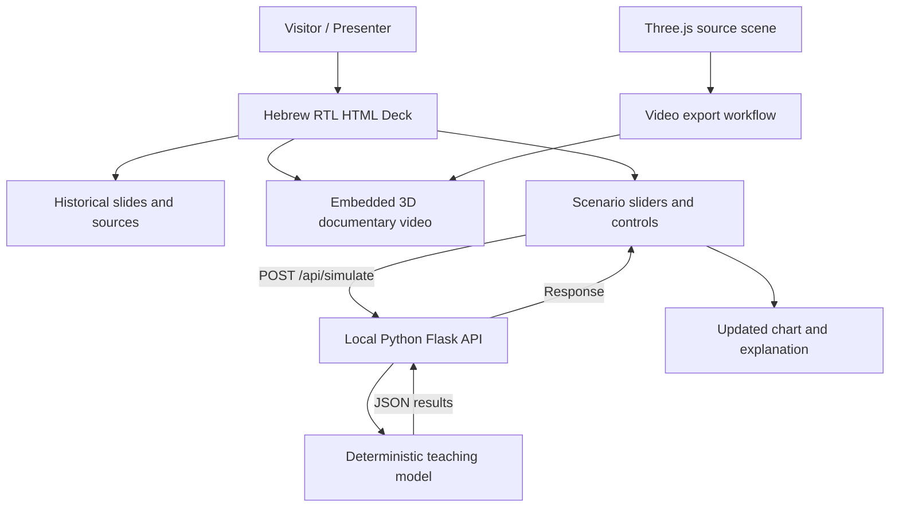

<div align="center">

# 🏦 BLACK THURSDAY

### יום חמישי השחור — משבר מניות הבנקים בישראל, 1983

**The Political Economy of Israel's 1983 Bank-Share Crisis**

**An interactive historical documentary · 3D animation · Python-powered policy lab**

**University of Haifa · Political Science · AI & Vibe Coding · Assignment 01**

**Project team: Yonatan & Liron**

[Project Scope](#-project-overview) · [Development Status](#-development-status) · [Experience](#-the-planned-experience) · [Run Locally](#-running-the-project) · [Sources](#-historical-research) · [Documentation](#-documentation--development-evidence)

</div>

---

> [!IMPORTANT]
> **Current status — 2 November 2026: Planning and development preparation.** The team has reported committing the initial `PRD.md` and granting both collaborators access. The historical research, storyboard, and master implementation prompt have been drafted, but their presence in this GitHub repository has **not yet been independently verified**. The HTML presentation, playable 3D video, and live Python simulation are **planned deliverables**, **not completed features**. This README will be updated with real instructions and screenshots as each milestone is implemented and tested.

## 🎯 Project overview

**Black Thursday** is a Hebrew-language, interactive educational presentation exploring **Israel's 1983 bank-share crisis** through the lens of **political economy**.

Rather than treating the crisis as a single-day market crash or the fault of one politician, the project asks how the incentives of banks, the decisions of investors, the responsibilities of regulatory institutions, and the government's intervention interacted over time. It examines the tensions between **financial stability, public accountability, government responsibility, and the distribution of risk**.

The finished product is intended to combine three connected experiences:

1. A polished **14-slide, right-to-left HTML documentary**, with historical explanations, interactive diagrams, citations, and navigable chapters.
2. A **genuine object-based 3D animation**, built using Three.js, exported as a playable video, and embedded in the presentation.
3. An **interactive Python-based educational model**, allowing visitors to compare simplified hypothetical scenarios involving investor confidence, selling pressure, banks' support capacity, and the timing of government intervention.

**Central research question / שאלת המחקר**

> כיצד תרמו התמריצים והפעולות של בנקים, משקיעים, רשויות פיקוח ומנהיגים פוליטיים למשבר מניות הבנקים ב־1983, ומה מלמדת ההתערבות הממשלתית על אחריות, פיקוח וחלוקת סיכונים בין המדינה לשוק?

### Why political science?

This is more than a financial-history timeline. The case provides a concrete way to examine **institutions and incentives**, **conflicts of interest**, **regulatory oversight**, **state–market relations**, **systemic risk**, and **who ultimately bears the costs of emergency intervention**. Historical findings will be distinguished from our team's interpretation.

---

## 🚦 Development status

| Milestone | Status | Evidence / next action |
|---|---|---|
| Project concept and hybrid documentary/simulation direction | ✅ Planned | Agreed by team in project planning |
| Initial product requirements document (`PRD.md`) | ✅ Team-reported commit | Original PRD committed to existing repository; confirm version on GitHub |
| Historical timeline, 14-slide storyboard, source/claim register | 🟡 Drafted | Add Phase 3 files to this repository and complete editorial review |
| Master presentation implementation instructions | 🟡 Drafted | Add the actual prompt to `prompts/` and log its execution |
| Root `README.md` | 🟡 Initial draft | Add this file to repository root; update as milestones are tested |
| Navigable Hebrew RTL HTML presentation | ⬜ Not yet verified | Implement and test all planned slides |
| Three.js scene **and actual embedded video file** | ⬜ Not yet verified | Build, export, embed, and verify browser playback |
| Running Python API and interactive chart | ⬜ Not yet verified | Implement backend, integrate browser controls, test responses |
| Screenshots, test report, external red-team critique | ⬜ Not yet verified | Capture real outputs and record actual tests |
| Final GitHub access and individual Moodle PDF submissions | ⬜ Pending | Verify repository permissions and each student's submission |

**Legend:** ✅ confirmed by the team / planning record · 🟡 drafted or awaiting repository verification · ⬜ not yet independently verified or completed. These marks are **not** automated build/test indicators.

### Planned milestones

`Research & PRD` → `HTML foundation` → `Academic slides & design` → `Three.js film` → `Python integration` → `QA & red team` → `Submission`

**Last README content review:** 2026-11-02. Keep this date and table current after each meaningful push.

---

## ✨ The planned experience

### A historical documentary you can explore

The presentation will be designed for a short university demonstration and for independent viewing: **14 Hebrew RTL slides**, navigation buttons, keyboard support, clear source references, and diagrams that explain financial mechanisms without relying on dense paragraphs.

| Chapter | Slides | What the audience learns |
|---|---|---|
| **Context & institutions** | 1–3 | The crisis, economic background, and the main actors |
| **How share-price support worked** | 4–6 | `ויסות מניות הבנקים`, conflicts of interest, and finite resources |
| **The October 1983 crisis** | 7–9 | Warning signs, the market shutdown, and the explanatory 3D film |
| **Intervention & accountability** | 10–12 | The government arrangement, public costs, and the Bejski inquiry |
| **Policy lab & conclusions** | 13–14 | Hypothetical scenarios, interpretation, limitations, and sources |

### 🎞️ A real 3D animation — not a slideshow of still images

The animation will visualize **bank-share support, growing selling pressure, constrained resources, the October crisis, and government intervention** through animated three-dimensional objects, lighting, and moving cameras.

- **Planned technology:** Three.js scene built in code.
- **Planned presentation integration:** locally stored, playable MP4/WebM film in a slide-embedded `<video>` player.
- **Planned duration:** approximately 60–70 seconds; final runtime will be measured after export.
- **Integrity rule:** visual objects will be labeled as *schematic illustrations*, not authentic footage, real trades, or reconstructed historical prices.

### 🐍 Python-powered policy lab

The planned simulation will run in **Python**, expose results through a small **Flask** HTTP service, and update an interactive chart inside the HTML presentation. Visitors will be able to change simplified parameters and compare results across illustrative time periods.

| Teaching-model input | Purpose |
|---|---|
| Investor confidence | Illustrates confidence-related selling behavior |
| Selling pressure | Illustrates stress from shareholders wishing to sell |
| Bank support capacity | Demonstrates limits on absorbing selling pressure |
| Government intervention timing | Compares alternative assumptions about intervention |

> [!CAUTION]
> **Simulation ≠ history.** The planned model is an educational thought experiment. Its values are **not** observed 1983 stock prices, a fitted econometric estimate, reliable historical counterfactuals, or an investment forecast. Visualizations will use synthetic periods (e.g., 1–12), explicit units, assumptions, and a conspicuous Hebrew disclaimer.

---

## 🖼️ Presentation gallery

**Real application screenshots will appear here after the corresponding features have been implemented and captured.** We will not present AI-generated mockups as screenshots of functional software.

| Planned screenshot | What it must demonstrate | Proposed repository path |
|---|---|---|
| Title slide | Working HTML slide and final visual design | `media/screenshots/slide-01.png` |
| Financial mechanism | A legible source-backed interactive diagram | `media/screenshots/share-support.png` |
| 3D film | A real frame from the **exported, playable** movie | `media/screenshots/threejs-video.png` |
| Python simulation | A chart rendered after a **real Python API response** | `media/screenshots/python-simulation.png` |

<!-- WHEN REAL OUTPUTS EXIST, replace this placeholder with actual embeds, for example:


Do not enable these links until the image files have been committed and verified on GitHub.
-->

---

## 🧰 Planned technology stack and architecture

| Layer | Technology | Role |
|---|---|---|
| Presentation | HTML5, CSS3, JavaScript | Accessible Hebrew RTL slide interface and navigation |
| 3D animation | Three.js | Code-generated 3D geometry, scenes, and moving cameras |
| Video | HTML5 `<video>` + local MP4/WebM asset | Reliable playback inside the deck |
| Backend | Python 3 + Flask | Serve the app and process hypothetical simulation inputs |
| Visualization | SVG / Canvas or a lightweight chart module | Show computed scenario results |
| Development | Git, GitHub, AI coding assistant | Version control, collaboration, and iterative engineering |



**Architecture note:** This is a **planned** architecture, not documentation of a completed deployment. The implementation must genuinely call Python to count as an integrated feature.

---

## 💻 Running the project

> **Not yet executable as a full application.** The repository currently has a team-reported PRD commit; no complete application/runtime has been independently verified. Do **not** assume the following instructions work until the corresponding files exist and a clean-install test has passed.

### Read the current project specification

Open [`PRD.md`](PRD.md) in this repository for the product requirements and intended functionality. The detailed implementation prompt and Phase 3 research documents are expected to be added separately.

### Proposed local launch procedure — **to be tested and finalized after implementation**

Requirements *once the app exists*: Windows PowerShell, Git, Python 3.11+ and a modern browser (Chrome or Edge). The final `requirements.txt`, port, and commands must be confirmed by an actual run.

```powershell
# 1. Clone the repository
 git clone https://github.com/yonti32-ux/polsci01-assignment-01-Project-Black-Thursday.git
 cd polsci01-assignment-01-Project-Black-Thursday

# 2. Create a Python environment (only after the Python files exist)
 py -3 -m venv .venv

# 3. Install dependencies (only after requirements.txt exists)
 .\.venv\Scripts\python.exe -m pip install -r requirements.txt

# 4. Start the local presentation server (only after python/app.py exists)
 .\.venv\Scripts\python.exe python\app.py
```

**Planned** browser address: `http://127.0.0.1:8000/`. The implemented app may use a different port; update this README after a successful launch. At that time, also document navigation keys, simulation controls, video playback, and troubleshooting, with screenshots.

> [!TIP]
> Once a runnable version is available, follow these commands on a fresh checkout. If any command fails, record the failure and fix the README or the software before claiming the app is ready.

---

## 📚 Historical research

Our research prioritizes institutional documentation, contemporary records, and scholarly analysis. The narrative distinguishes **verified historical facts**, **the team's political-science analysis**, **schematic animation**, and **hypothetical model output**.

**Selected starting references:**

- **State Comptroller of Israel (1993)** — [ההיערכות למכירת מניות הבנקים שבהסדר](https://library.mevaker.gov.il/sites/DigitalLibrary/Pages/Publications/641.aspx): intervention, state exposure, and accounting caveats.
- **Natalie Leonard (2021), Yale Program on Financial Stability** — [Israeli Bank Shares Arrangement](https://elischolar.library.yale.edu/journal-of-financial-crises/vol3/iss3/13/): crisis background, share support, and government arrangement.
- **Blass & Grossman (1996), Bank of Israel working paper** — [A Harmful Guarantee? The 1983 Israel Bank Shares Crisis Revisited](https://www.boi.org.il/media/rn3favup/dp9603e.pdf): research on the crisis and intervention.
- **Israel Ministry of Justice** — [פרשת ויסות מניות הבנקים](https://www.gov.il/BlobFolder/reports/roots_1983/he/roots-1983.pdf): legal and institutional retrospective.

For detailed claims, source locations, and unresolved questions, the planned research documents are `research/sources.md`, `research/historical-timeline.md`, and `research/claim-register.csv`. **Only link to them as completed documents once they are committed to this repository.**

### Accuracy safeguards

- The 1983 crisis cannot responsibly be attributed to **Yoram Aridor alone**. He served as **Minister of Finance**, not “Minister of Economy.”
- **6 October 1983** marks the stock-exchange shutdown. The precise language around the late-October reopening should be tied to an authoritative original record if an exact reopening date is displayed.
- The **1983 banking rescue** and the **1985 macroeconomic stabilization plan** are separate policies.
- Government **expenditure** on the arrangement must not be represented as the state's definitive **net loss** without accounting for its acquired shares and subsequent proceeds.
- Do not invent contemporaneous quotations, archival footage, trading statistics, newspaper pages, or share-price curves.
- Only use historical photographs and artwork after checking permissions, licenses, and attribution; original charts and 3D objects are preferred.

---

## 🗂️ Documentation & development evidence

The course evaluates **how the team directs, tests, and improves the AI-generated product**, as well as the final output. We preserve decisions and meaningful iterations rather than manufacturing a perfect-looking history after the fact.

| Path | Purpose | Availability |
|---|---|---|
| `PRD.md` | The initial product requirements document | Team reports committed |
| `README.md` | Project introduction, current status, verified launch instructions and gallery | **This file — ready to commit** |
| `research/` | Historical timeline, references, claim-level verification | Phase 3 drafts; repository integration pending verification |
| `content/storyboard.md` | Hebrew script, visuals, narrator notes, and interactions for 14 slides | Phase 3 draft; repository integration pending verification |
| `prompts/` | Real prompts, AI outputs, corrections and specific instructions | Establish in repository; never fabricate earlier messages |
| `animation/` | Three.js source and reproducible video export steps | Planned |
| `presentation/` | The actual HTML/CSS/JavaScript deck | Planned |
| `python/` | Flask app, model and tests | Planned |
| `media/` | Final video, original/cleared imagery, **real** screenshots | Planned |
| `docs/development-log.md` | Milestones, decisions and known limitations | Planned |
| `docs/testing-report.md` | Tests attempted, failures, fixes and evidence | Planned |
| `docs/release-checklist.md` | Final GitHub, rights and university submission review | Planned |

### Our development protocol

1. **Plan:** Define the expected change in the PRD or an explicit prompt.
2. **Build:** Implement a bounded milestone; avoid unrelated changes.
3. **Test:** Run the actual feature and record observed results.
4. **Review:** Critique factual accuracy, UI/UX, accessibility, code, and historical interpretation; use an independent LLM as a skeptical reviewer when practical.
5. **Improve:** Make precise corrections, explaining what changed and why.
6. **Document:** Update `README.md` **at the same milestone**, add genuine prompts and test evidence, commit and push meaningful changes.

**At every meaningful release, update:** the status table and date; new features; verified run commands; actual screenshots and media; sources and claims; outstanding defects; test results; latest milestone and next action. Never mark untested requirements as complete.

### Collaboration

**Yonatan and Liron** are collaborating on research, editorial judgment, implementation, testing, and documentation. Specific responsibilities may vary by milestone. Both students remain responsible for verifying the political-science conclusions; AI assistance does not replace their judgment.

---

## ✅ Release and submission checklist

The following are **pending checks**, not claims that submission has occurred:

- [ ] Repository contains a complete, working Hebrew RTL HTML presentation.
- [ ] An actual playable 3D animation video is embedded and its Three.js source is committed.
- [ ] Python executes in the presentation workflow and visibly updates at least one component.
- [ ] Historical claims and quantitative statements have traceable references.
- [ ] README includes **real** screenshots of the deck, video and Python results.
- [ ] `PRD.md`, `prompts/`, sources, tests and milestone history are committed.
- [ ] The repository is **public**, or the lecturer has verified access via `rmisegal@gmail.com`.
- [ ] The team has a unique group code of **exactly eight characters** (without spaces).
- [ ] The official Word reporting template is filled **without layout changes** and exported to PDF, with filename `xxxxxxxx-exyy.pdf` (verify exercise number).
- [ ] **Each student separately** uploads their PDF to Moodle and verifies receipt.
- [ ] The team writes a justified, evidence-based recommended self-grade.

**Privacy:** Student ID numbers, private certificates and medical documents must **not** be committed to this repository.

---

## 📝 README change log

| Date | Revision | Description |
|---|---|---|
| 2026-11-02 | `README v0.1 — project introduction` | Initial living README based on the planning record, course requirements, and master implementation specification. No implementation screenshots, verified runtime, or tests claimed. |

*Future README revisions should be committed alongside the actual development milestone they describe.*

---

<div align="center">

**Project Black Thursday** · *History, institutions, and political economy — made interactive.*

Developed by **Yonatan & Liron** · University of Haifa

[Back to top ↑](#-black-thursday)

</div>
